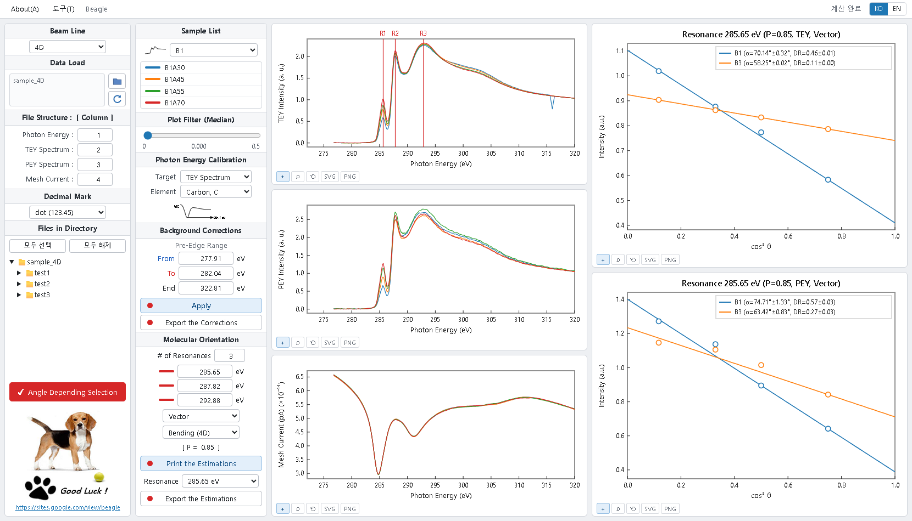

# Beagle (web)

[한국어](#한국어) · [English](#english)

**▶ 실행 / Run: <https://whiang.github.io/Beagle/>**

PAL 4D / 10A2 빔라인 NEXAFS 분석 소프트웨어 **Beagle**(원본: LabVIEW)의 웹 버전입니다.
A web version of **Beagle**, the NEXAFS analysis software for the PAL 4D / 10A2 beamlines (original: LabVIEW).

> 인용 / Citation: Park et al., *J. Synchrotron Rad.* **31**(1) (2024). [doi:10.1107/S1600577523008755](https://doi.org/10.1107/S1600577523008755)
> 홈페이지 / Website: <https://sites.google.com/view/beagle>
> 이용 통계 / Usage statistics: <https://whiang.github.io/Beagle/stats.html>
> 이전 버전 / Previous version: [1.0.0](https://whiang.github.io/Beagle/v1.0/) (현재 1.1.0 / current 1.1.0)

---

## 한국어

### 실행
- **웹에서 바로:** <https://whiang.github.io/Beagle/> (Chrome, Edge 권장)
- **오프라인:** 이 저장소의 [`index.html`](index.html)을 내려받아(Raw → 다른 이름으로 저장) 더블클릭하면 인터넷 없이도 실행됩니다.
- 설치가 필요 없고, **모든 계산은 브라우저 안에서만** 이루어집니다. 측정 데이터는 서버나 외부로 전송되지 않습니다.

### 사용 순서 (원본과 같은 4열 화면)
1. **Beam Line**(4D / 10A2), **File Structure**(열 번호), **Decimal Mark**(점/쉼표)를 데이터에 맞게 고릅니다.
2. **Data Load** 폴더 버튼으로 폴더를 열거나 폴더·파일을 창에 끌어다 놓고, **Files in Directory**에서 파일을 체크합니다. 파일 이름 규칙은 `<실험명>A<2자리 각도>.DAT` (예: `B1A30.DAT`). **Angle Depending Selection**이 켜져 있으면 같은 실험명의 각도 파일이 함께 선택되고, 그래프에는 Sample List에서 고른 샘플이 보입니다. 끄면 파일을 하나씩 체크할 수 있고, 체크한 모든 파일이 샘플에 상관없이 한 그래프에 함께 그려집니다(1.1). 계산·출력은 어느 경우든 샘플별입니다.
3. 필요하면 **Plot Filter**(스파이크 제거 임계값), **Photon Energy Calibration**(Carbon: Mesh 전류의 C 1s 흡수로 284.7 eV 보정 / Atomic Element: 직접 Shift)을 설정합니다. **Target**은 커서를 표시할 그래프(TEY/PEY)입니다.
4. 그래프의 **FROM / TO / END** 커서(또는 숫자 입력)로 pre-edge 범위와 정규화 기준점을 정하고 **Apply**를 누릅니다.
5. **R1, R2, …** 커서로 공명 에너지를 정하고 **Orbital**(Vector/Plane), **Beam Line**(Bending P=0.85 / Undulator P=1.00 / 직접 입력)을 고른 뒤 **Print the Estimations**를 누르면 오른쪽에 I vs cos²θ 피팅과 분자 배향각 α, 이색비 DR이 표시됩니다.
6. **Export the Corrections / Export the Estimations**로 저장합니다. 단계 버튼을 다시 누르면 그 단계가 해제됩니다.

### 출력 (원본과 같은 이름·형식)
| 파일 | 내용 |
|---|---|
| `save/norm/<실험명>_norm_TEY.dat`, `_PEY.dat` | 보정된 스펙트럼 (에너지 + 각도별 열) |
| `save/<공명E> eV/<실험명>/<실험명>_<공명E> eV_(P=…, TEYo, Vector).dat` | 측정점 (cos²θ, I). `TEY-` = 피팅선, PEY도 같음 |
| `save/NORM.pdf`, `save/FIT.pdf` | 정규화 스펙트럼·피팅 그래프 (원본과 같은 574×420 pt). 같은 이름이 있으면 NORM0.pdf, NORM1.pdf… |
| 그래프 SVG / PNG | 각 그래프 아래 버튼 |

Chrome/Edge에서는 고른 폴더 아래 `save/`에 바로 저장하고, 그 밖의 브라우저에서는 같은 구조의 `save.zip`을 내려받습니다.
원본의 "If you have Origin9.0"(Origin 자동 출력)은 웹판에 없습니다. Origin에서는 위 .dat 파일을 직접 불러오면 됩니다.

### 웹판에서 추가된 기능 (원본 화면 배치는 그대로)
- 폴더·파일 끌어다 놓기, "모두 선택"으로 여러 샘플 일괄 처리
- Angle Depending Selection을 끄면 다른 샘플의 스펙트럼도 한 그래프에 함께 표시 (1.1)
- 도구 메뉴: 설정 저장/불러오기(JSON), 결과 요약표(α, DR, CSV 저장)
- 그래프 박스 줌, 커서 위치 숫자 입력. 휴대폰에서도 4열 전체를 한 화면에 표시 (확대는 손가락으로)
- 한국어/English 전환

### 원본과의 일치
계산은 LabVIEW 원본(2021 Beagle)과 같은 방법으로 구현했고, 원본 출력 및 LabVIEW 실행 결과와 대조해 검증했습니다.
- 원본 출력 파일(정규화 스펙트럼, 피팅 결과)을 **바이트 단위로 동일하게** 재현
- 정규화 스펙트럼 상대오차 ≤ 4.2×10⁻⁷, α 차이 ≤ 4.2×10⁻⁶°
- 지원 빔라인: 4D, 10A2

---

## English

### Run
- **Online:** <https://whiang.github.io/Beagle/> (Chrome or Edge recommended)
- **Offline:** download [`index.html`](index.html) from this repository (Raw → Save as) and open it; no internet connection is needed.
- Nothing to install. **All calculations run inside the browser**; measurement data is never sent to a server.

### Workflow (same four-column screen as the original)
1. Choose **Beam Line** (4D / 10A2), **File Structure** (column numbers) and **Decimal Mark** (dot/comma).
2. Open a folder with the **Data Load** folder button or drop folders/files onto the window, then check files in **Files in Directory**. File names follow `<name>A<2-digit angle>.DAT` (e.g. `B1A30.DAT`). With **Angle Depending Selection** on, all angle files of the same experiment are selected together and the graphs show the sample chosen in Sample List. With it off, files are checked one by one and every checked file is drawn in the same graphs, whatever its sample (1.1). Calculations and outputs are per sample either way.
3. Optionally set **Plot Filter** (spike threshold) and **Photon Energy Calibration** (Carbon: aligns the C 1s dip of the mesh current to 284.7 eV / Atomic Element: manual shift). **Target** is the graph (TEY/PEY) that shows the cursors.
4. Set the pre-edge range and normalization point with the **FROM / TO / END** cursors (or type the values) and press **Apply**.
5. Place the **R1, R2, …** cursors on the resonances, choose **Orbital** (Vector/Plane) and **Beam Line** (Bending P=0.85 / Undulator P=1.00 / other), then press **Print the Estimations**: the right column shows the I vs cos²θ fits with the molecular tilt angle α and the dichroic ratio DR.
6. Save with **Export the Corrections / Export the Estimations**. Pressing a step button again releases that step.

### Outputs (same names and formats as the original)
| File | Content |
|---|---|
| `save/norm/<name>_norm_TEY.dat`, `_PEY.dat` | corrected spectra (energy + one column per angle) |
| `save/<R> eV/<name>/<name>_<R> eV_(P=…, TEYo, Vector).dat` | points (cos²θ, I); `TEY-` = fit line; same for PEY |
| `save/NORM.pdf`, `save/FIT.pdf` | normalized spectra and fit graphs (574×420 pt like the original); NORM0.pdf, NORM1.pdf, … if the name is taken |
| graph SVG / PNG | buttons under each graph |

Chrome/Edge write directly into `save/` under a folder you choose; other browsers download `save.zip` with the same structure.
The original's "If you have Origin9.0" option is not part of the web version; import the .dat files into Origin directly.

### Added in the web version (original layout kept)
- Drag & drop of folders/files; "Select all" for batch processing of many samples
- With Angle Depending Selection off, spectra of different samples are drawn in the same graphs (1.1)
- Tools menu: save/load settings (JSON), summary table (α, DR, CSV)
- Box zoom, numeric cursor positions; phones show the full four-column page (pinch to zoom)
- Korean/English switch

### Agreement with the original
The calculations follow the LabVIEW original (Beagle 2021) and were checked against its outputs and against LabVIEW runs:
- original output files (normalized spectra, fit results) reproduced **byte for byte**
- normalized spectra within 4.2×10⁻⁷ relative error, α within 4.2×10⁻⁶°
- supported beamlines: 4D, 10A2
